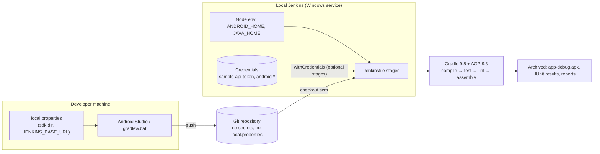

# JenkinsLearningApp

A native Android app (Kotlin, Jetpack Compose, Clean Architecture + MVI, Koin,
Retrofit/OkHttp/Gson) built to **learn how one Android project is built
locally by developers and automatically by a local Jenkins server, while
keeping credentials out of Git and out of the APK.**

The app itself is a Jenkins companion:

| Screen | What it does |
|---|---|
| **Dashboard** | Connection status, server URL, Jenkins version, job count, last build, last successful build, refresh |
| **Jobs** | All jobs (folders flattened) with status, last build number, duration, timestamp; open details; *Build now* when buildable |
| **Job details → Build details** | Build result, start time, duration, JUnit counts, artifact links, console output (redacted, tail of long logs), auto-refresh while running |
| **Credentials** | The credential IDs this project's Jenkinsfile uses (metadata only), plus "where should a value live?" comparisons |
| **Learn** | Pipeline lifecycle, Jenkinsfile syntax, Gradle CI tasks, debug vs release, tests, binding, env vars, `local.properties`, archiving, troubleshooting |
| **Settings** | Sample vs Live mode, Jenkins URL, username, API token (memory only), connection test, and *which machine built this APK* |

It starts in **Sample mode** (clearly labeled built-in data, no network), so it
runs without Jenkins.

---

## Quick start

```powershell
# Android Studio Quail 3: File → Open → JenkinsLearningApp, let Gradle sync, Run 'app'.
# Or from PowerShell in the project folder:
.\gradlew.bat :app:testDebugUnitTest
.\gradlew.bat :app:assembleDebug
.\gradlew.bat :app:installDebug
```

Then follow, in order:

1. [docs/02-local-development.md](docs/02-local-development.md): JDK/SDK, `local.properties`, emulator vs device networking, cleartext rules
2. [docs/03-jenkins-setup-windows.md](docs/03-jenkins-setup-windows.md): install Jenkins on Windows 11, SDK for the service, plugins, credentials, job, download the APK
3. [docs/05-pipeline-walkthrough.md](docs/05-pipeline-walkthrough.md): every stage explained, with a sequence diagram
4. [docs/04-credentials-and-secrets.md](docs/04-credentials-and-secrets.md): global vs folder credentials, `local.properties`, env vars, BuildConfig, build-time vs runtime secrets, masking limits
5. [docs/06-troubleshooting.md](docs/06-troubleshooting.md)
6. [docs/01-architecture.md](docs/01-architecture.md): layers, MVI, Koin, networking design

## How the same project builds in both places



| | Developer machine | Jenkins |
|---|---|---|
| SDK location | `sdk.dir` in `local.properties` | `ANDROID_HOME` on the node |
| JDK | Android Studio's Gradle JDK | `JAVA_HOME` on the node |
| Default Jenkins URL in BuildConfig | `local.properties` `JENKINS_BASE_URL` (optional) | env `JENKINS_BASE_URL` (optional) or default |
| Build number in the app | `local` | Jenkins `BUILD_NUMBER` |
| Build-time secrets | not needed (optionally a shell env var) | `withCredentials` from the credential store |
| Release signing | not configured → unsigned release | gated `Release APK` stage with credentials |

## Project layout

```text
JenkinsLearningApp/
├── app/
│   ├── build.gradle.kts            config resolution, BuildConfig, signing, :app:verifySampleToken
│   ├── proguard-rules.pro
│   └── src/
│       ├── main/java/com/example/jenkinslearning/   app, core, data, domain, presentation, feature
│       ├── main/res/xml/network_security_config.xml      HTTPS only
│       ├── debug/res/xml/network_security_config.xml     cleartext only for 10.0.2.2 / localhost
│       ├── test/                    JVM unit + MockWebServer tests, JSON fixtures
│       └── androidTest/             Compose UI test (needs emulator)
├── ci/windows/verify-env.bat       used by Jenkinsfile
├── ci/linux/{Jenkinsfile,verify-env.sh}
├── docs/
├── gradle/libs.versions.toml       all versions
├── gradle/wrapper/                 Gradle 9.5.0 wrapper (commit gradle-wrapper.jar)
├── Jenkinsfile                     Windows agent pipeline
├── local.properties.example
├── .gitignore / .gitattributes
└── build.gradle.kts / settings.gradle.kts / gradle.properties
```

## Versions

| Component | Version | Why |
|---|---|---|
| Android Gradle Plugin | 9.3.3 | Highest supported by Android Studio Quail 3 |
| Gradle | 9.5.0 | Minimum for AGP 9.3 |
| Kotlin (+ Compose compiler plugin) | 2.4.0 | Stable, compatible with Gradle 9.5; AGP 9 built-in Kotlin |
| compileSdk / targetSdk / minSdk | 37 / 36 / 26 | Current AndroidX/Compose compile against 37 |
| Compose BOM | 2026.09.00 | |
| AndroidX core / activity / lifecycle / navigation | 1.19.1 / 1.13.0 / 2.11.0 / 2.10.2 | Lifecycle 2.11 needs AGP ≥ 9.2 |
| Koin | 4.2.2 (BOM) | |
| Retrofit / OkHttp / Gson | 3.0.0 / 5.5.0 / 2.14.0 | |
| Coroutines | 1.11.0 | |
| JUnit / MockK / Turbine / MockWebServer | 4.13.2 / 1.14.11 / 1.2.1 / mockwebserver3 5.5.0 | |

## Verification status

This project was written in a cloud workspace that **has no Android SDK and can't reach
Google Maven, Maven Central or the Gradle distribution server**. What was and
wasn't verified there:

**Verified (actually executed):**

- Kotlin 2.4.0 compiler: all framework-free code compiles (core, domain, DTOs,
  mappers, error mapping, redaction, URL parsing, settings contract).
- **46 unit tests passed** with JUnit 4.13.2 (built from source):
  `JenkinsJobPathTest`, `JenkinsUrlParserTest`, `SecretRedactorTest`,
  `ErrorMappingTest`, `TimeFormatTest`, `CredentialSafetyTest`,
  `JenkinsMappersTest` (real Gson 2.14.0 on Jenkins-shaped JSON), `DashboardSummaryTest`.
  The first run caught a real bug (a URL without `http://` reported as
  "malformed" instead of "add http://"), which was fixed.
- All Kotlin files parse (no syntax errors). All XML resources are well-formed.
- `ci/linux/verify-env.sh` was run with and without an SDK (exit 0 / 1).
  Both Jenkinsfiles were checked for balanced structure and for Groovy
  interpolation of secrets.

**Not verified there (needs your machine):** Gradle sync, `assembleDebug`,
the coroutine/ViewModel/MockWebServer tests, lint, `verify-env.bat`, and a real
Jenkins run. Run these and share the output if anything fails:

```powershell
.\gradlew.bat --version
.\gradlew.bat --no-daemon --stacktrace :app:testDebugUnitTest
.\gradlew.bat --no-daemon --stacktrace :app:assembleDebug
.\gradlew.bat --no-daemon :app:lintDebug
ci\windows\verify-env.bat
```

If Gradle reports a dependency that can't be resolved, or a version
incompatibility, paste the **first** error block. Versions are all in
`gradle/libs.versions.toml`.

Before the first Jenkins run, pin the wrapper checksum (optional but
recommended): add `distributionSha256Sum=<sha256 of gradle-9.5.0-bin.zip from
gradle.org/release-checksums>` to `gradle/wrapper/gradle-wrapper.properties`.
