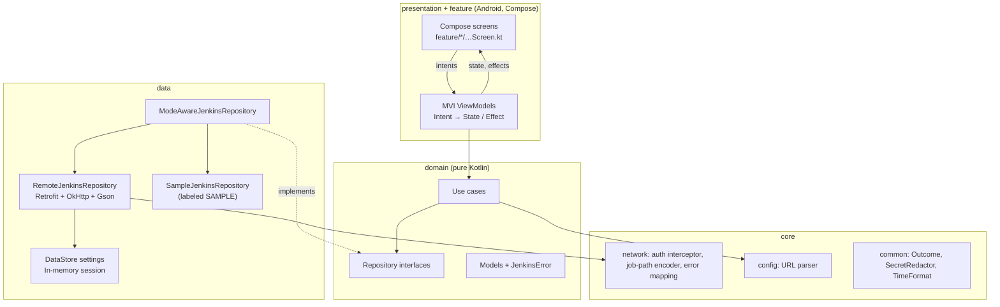

# 1. Architecture

JenkinsLearningApp is a **single-module** Android app (`:app`) organized by
Clean Architecture layers and MVI screens.

> **Why one module?** A multi-module setup (`:core`, `:data`, `:domain`, `:feature-*`)
> mainly pays off through build parallelism and enforced visibility in large
> teams. For a learning project it would also make every Jenkins build and
> every Gradle file harder to read. The layers are still strictly separated by
> package, and the `domain` package has no Android imports (enforced by
> convention and covered by plain-JVM unit tests). Splitting it into modules
> later is mechanical.

## Layers and dependency direction



Arrows point toward what a layer *depends on*. `domain` depends on nothing in
`data` or `presentation`; `data` implements `domain` interfaces.

## Package map

```text
app/src/main/java/com/example/jenkinslearning/
├── app/            Application (Koin start), MainActivity, AppModules.kt (all Koin modules)
├── core/
│   ├── common/     Outcome<T>, SecretRedactor, TimeFormat
│   ├── config/     JenkinsUrlParser (same rules as the Gradle script)
│   └── network/    HttpClientFactory, JenkinsAuthInterceptor, InMemoryCookieJar,
│                   JenkinsJobPath (folder-aware URL encoding), HttpErrorMapper, ThrowableErrorMapper
├── data/
│   ├── dto/        Gson DTOs (all fields nullable)
│   ├── mapper/     DTO → domain mapping
│   ├── remote/     JenkinsApi (Retrofit), JenkinsApiProvider (Retrofit per base URL)
│   ├── local/      DataStore settings (non-secret), in-memory session (token)
│   └── repository/ Remote, Sample, ModeAware, StaticLearningContent repositories
├── domain/
│   ├── error/      JenkinsError (typed, message-free errors)
│   ├── model/      Jenkins, connection and learning models
│   ├── repository/ Interfaces
│   └── usecase/    Dashboard, jobs, build, console, trigger, settings, learning
├── presentation/
│   ├── mvi/        MviViewModel base + CollectEffects
│   ├── navigation/ Routes + NavHost + bottom bar
│   ├── components/ Shared composables, ErrorMessages
│   └── theme/
└── feature/
    ├── dashboard/  A. Dashboard
    ├── jenkins/    B. Jobs list + job details (trigger build)
    ├── build/      C. Build details (tests, artifacts, console, polling)
    ├── credentials/D. Credential Learning Center
    ├── settings/   E. Build Configuration (URL, mode, token)
    └── learning/   F. Learning Center
```

## MVI in this project

Every screen has a contract file with three sealed types and a ViewModel:

| Piece | Type | Example (`feature/jenkins`) |
|---|---|---|
| Intent | `sealed interface` of user actions | `JobsIntent.TriggerBuild(job)` |
| State | immutable `data class` exposed as `StateFlow` | `JobsState(isLoading, jobs, source, error, triggeringJob)` |
| Effect | one-time events through a `Channel` | `JobsEffect.ShowMessage("Jenkins queued a build…")` |

`presentation/mvi/MviViewModel.kt`:

- `onIntent(intent)` is the only entry point from the UI.
- `setState { copy(...) }` updates state atomically (`MutableStateFlow.update`).
- Effects use `Channel(BUFFERED).receiveAsFlow()`, so each effect is delivered **once**
  and isn't replayed after rotation (unlike a `SharedFlow(replay = 1)`).
- `CollectEffects` collects with `repeatOnLifecycle(STARTED)`, so effects wait
  in the buffer while the app is in the background.
- Screens collect state with `collectAsStateWithLifecycle()`.
- Each load cancels the previous `Job`, so the newest request wins and old responses
  can't overwrite new state.
- `BuildDetailsViewModel` only polls a running build while the screen is
  STARTED (`LifecycleStartEffect` sends `ScreenStarted` / `ScreenStopped`).

No Composable calls a repository, use case or network API directly.

## Dependency injection (Koin)

All modules are in `app/AppModules.kt`:

| Koin module | Provides |
|---|---|
| `configModule` | `AppBuildInfo` from `BuildConfig`, the IO dispatcher |
| `networkModule` | `Gson`, base `OkHttpClient`, `JenkinsApiProvider`, `SecretRedactor` |
| `dataModule` | session, settings, live/sample/mode-aware repositories, learning content |
| `domainModule` | use cases (`factoryOf`) |
| `presentationModule` | ViewModels (`viewModelOf`, or `viewModel { params -> }` for screens with arguments) |

Everything uses constructor injection, so tests build objects directly with fakes and need no Koin at all.

## Networking

- **Runtime base URL:** Retrofit fixes its base URL when built, so
  `JenkinsApiProvider` creates a Retrofit instance per configured URL and caches
  it. Per-server clients come from `baseClient.newBuilder()` and share the
  connection pool.
- **Authentication:** HTTP Basic with *username + Jenkins API token*. Jenkins
  exempts API-token requests from CSRF checks. `JenkinsAuthInterceptor` adds the
  header only for the configured origin.
- **CSRF crumbs:** before a `POST`, the repository asks `/crumbIssuer/api/json`.
  A crumb is sent if one is issued; a 404 (issuer disabled) is fine. Cookies are
  kept in memory because Jenkins ties crumbs to the web session.
- **Folders:** `android/my app` becomes `job/android/job/my%20app` (each segment encoded).
- **Parameterized jobs** are triggered through `/buildWithParameters` (defaults are used).
- **Triggering** reports only what Jenkins says: *queued* (201 + queue item), never "succeeded".
- **Console output** is streamed, only the last 256 KB is kept, and it's passed
  through `SecretRedactor` before display.
- **Errors:** status codes and exceptions become a typed `JenkinsError`. Raw
  exception messages, URLs and bodies are never shown or logged.
- **Logging:** debug builds only, `BASIC` level (no headers or bodies), with
  `Authorization`, `Cookie` and crumb headers redacted as a safety net.

## Sample mode

`DataMode.SAMPLE` (the default) uses `SampleJenkinsRepository`. Every model
carries `source = DataSource.SAMPLE`, and every screen then shows a "Sample
data" banner. The sample "trigger" says *nothing was sent to Jenkins*.
