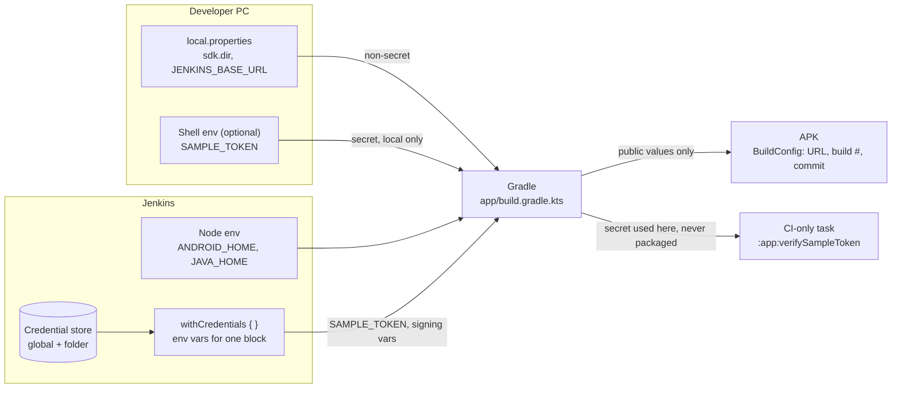

# 4. Credentials, configuration and secrets

The central question of this project: **how does the same Android project
build on a developer laptop and on Jenkins, while keeping secrets out of Git
and out of the APK?**

## 4.1 The six places a value can live

| # | Where | Lives in | Read by | OK for secrets? | In this project |
|---|---|---|---|---|---|
| 1 | **Jenkins global credentials** | Jenkins' encrypted store (`JENKINS_HOME`), *Global* domain | Any job that names the ID in `withCredentials` | **Yes**, the right place for CI secrets | `sample-api-token`, `android-*` |
| 2 | **Folder / job-scoped credentials** | The credential store of one folder | Only jobs inside that folder | **Yes**, with a smaller blast radius | `sample-config-file` (if created in folder `android`) |
| 3 | **`local.properties`** | Each developer's project root, ignored by Git; absent on Jenkins | Android Studio, Gradle on that machine | **No**: plain text, easy to leak | `sdk.dir`, `JENKINS_BASE_URL` |
| 4 | **Environment variables / build parameters** | The build process (node settings, `environment {}`, `parameters {}`, `withCredentials`) | Gradle (`providers.environmentVariable`) and every command in the step | **Only** when injected by `withCredentials` and never printed | `ANDROID_HOME`, `BUILD_NUMBER`, `SAMPLE_TOKEN` |
| 5 | **BuildConfig / generated resources** | Compiled into the APK | The app, **and anyone with the APK** | **Never** | `DEFAULT_JENKINS_BASE_URL`, `CI_BUILD_NUMBER`, `CI_GIT_COMMIT` |
| 6a | **Build-time secret** | Jenkins credentials → env var during one stage | A Gradle task on the CI agent | Yes, if it never reaches the APK | `SAMPLE_TOKEN`, signing passwords |
| 6b | **Runtime secret** | Entered or fetched by the app after install | The app, for the current user | Store only in memory or encrypted with Android Keystore | The user's Jenkins API token in Settings |



## 4.2 Jenkins credentials in practice

**Credential ID vs value.** The Jenkinsfile contains only IDs
(`'sample-api-token'`). Values are entered once in the Jenkins UI and stored
encrypted under `JENKINS_HOME`. Anyone who can read the Jenkinsfile learns the
ID, not the secret.

**Kinds used here:**

- *Secret text*: a single string (API token, password). Binding: `string(credentialsId:, variable:)`.
- *Secret file*: a whole file (keystore, service-account JSON). Binding:
  `file(credentialsId:, variable:)`. The variable holds a **path** to a
  temporary copy, deleted after the block.
- *Username with password*: two values. Binding:
  `usernamePassword(credentialsId:, usernameVariable:, passwordVariable:)`. Used
  here for key alias + key password.

**Global vs folder scope:**

- *Global* credentials are available to every job on the controller. Convenient, but
  every job author could bind them.
- *Folder* credentials (Folder → Credentials) are available only to jobs inside
  that folder. Put release keys in the folder of the release jobs, not globally.
- *System* scope (not used here) is for Jenkins itself (e.g. connecting agents);
  pipelines can't bind it.

**Binding (from the root `Jenkinsfile`):**

```groovy
withCredentials([string(credentialsId: 'sample-api-token', variable: 'SAMPLE_TOKEN')]) {
    bat 'gradlew.bat %GRADLE_ARGS% :app:verifySampleToken'
}
```

- The variable exists **only inside the block**.
- **Single quotes** matter. With `"... ${SAMPLE_TOKEN} ..."` Groovy would paste the
  secret into the command text before the shell runs, and Jenkins warns about
  "insecure interpolation". With single quotes, the shell (`%SAMPLE_TOKEN%` /
  `$SAMPLE_TOKEN`) or Gradle reads it from the environment.
- Secrets travel as **environment variables or files**, never as command-line
  arguments. On a shared machine, other processes can see a process's arguments
  (Task Manager → Details → Command line; `ps` on Linux).

## 4.3 What masking does and doesn't do

Jenkins replaces the **exact** bound values with `****` in the console log. That's a
safety net, not protection:

| Leak | Masked? |
|---|---|
| `echo %SAMPLE_TOKEN%` | Yes (exact match) |
| The secret base64-encoded, URL-encoded, reversed, split across lines | **No** |
| A tool printing part of the secret, or a derived value (hash, JWT) | **No** |
| The secret written to a file that you then `archiveArtifacts` | **No**: it's in the artifact |
| The secret in a test report, lint report or crash log | **No** |
| Secrets in `environment { }` or in build **parameters** | **No**: those aren't credentials (parameters are saved with the build record) |
| `set` / `env` / `printenv` / `gradlew --debug` dumping the environment | Exact values masked; derived ones not |
| Other processes on the agent while the step runs | Not a log concern; anyone with access to the agent can inspect processes and files |

The app adds a second layer for console output it displays
(`core/common/SecretRedactor.kt`): `key=value` pairs named like
password/token/secret/key, `Authorization:` headers, `user:pass@` in URLs,
GitHub and AWS key formats, JWTs, PEM private keys, and the user's own
session token. It's also best-effort. The only reliable rule: **don't print
secrets.**

## 4.4 Gradle: reading configuration safely

From `app/build.gradle.kts`:

```kotlin
// Non-secret: env var → -P property → local.properties → default
fun nonSecretSetting(envName: String, gradlePropertyName: String, localKey: String): String? =
    providers.environmentVariable(envName).orNull?.trim()?.takeIf { it.isNotEmpty() }
        ?: providers.gradleProperty(gradlePropertyName).orNull?.trim()?.takeIf { it.isNotEmpty() }
        ?: localProperties.getProperty(localKey)?.trim()?.takeIf { it.isNotEmpty() }

// Secret: read lazily, used inside a task, never packaged, never printed
tasks.register<VerifyCiSecretTask>("verifySampleToken") {
    secretName.set("SAMPLE_TOKEN")
    secretValue.set(providers.environmentVariable("SAMPLE_TOKEN"))  // @Internal property
}
```

Points to notice:

- **`providers.environmentVariable(...)` doesn't make a value safe.** It's just the
  configuration-cache-friendly way to read the environment. The script decides
  what happens next, and printing the value would still leak it.
- **Missing or invalid values are handled.** A missing `local.properties` (as on
  Jenkins) is fine. An invalid `JENKINS_BASE_URL` falls back to the default with
  a warning that **doesn't echo the value** (it might contain credentials).
- **The secret is `@Internal`,** so it isn't a tracked task input. Gradle hashes
  task inputs into the build cache, and that's not where a token belongs.
- **Configuration cache:** if you enable it later, values a build script reads
  *at configuration time* are stored (encrypted) in the configuration cache.
  The release `signingConfigs` block reads its env vars at configuration time.
  That's acceptable on an ephemeral CI workspace, but worth knowing.

## 4.5 Never put secrets in the APK

```kotlin
// ✅ public values: fine in BuildConfig
buildConfigField("String", "CI_BUILD_NUMBER", "\"42\"")

// ❌ NEVER
buildConfigField("String", "API_SECRET", "\"${System.getenv("API_SECRET")}\"")
resValue("string", "api_key", "...")
manifestPlaceholders["apiKey"] = "..."
// …or a secret in assets/, raw/, or a generated source file
```

An APK is a zip. `BuildConfig` constants, string resources, manifest values
and assets come back out with ordinary tools (`apkanalyzer`, `jadx`,
`apktool`) in minutes. R8 obfuscation doesn't help: it renames code, not
string constants. If a build step needs a secret (uploading mapping files,
signing, publishing), **run that step on Jenkins** with `withCredentials`, as
`:app:verifySampleToken` and the release stage do. If the *app* needs to call
a protected API, use your own backend that holds the secret, plus per-user
authentication.

## 4.6 Release signing (optional, gated)

- The keystore (`.jks`) and its passwords are **never** committed (`.gitignore`
  covers `*.jks`, `*.keystore`, `keystore.properties`) and never shipped.
- The `Release APK (optional)` stage runs only when `BUILD_RELEASE` is checked. It binds:
  `android-release-keystore` → `ANDROID_KEYSTORE_FILE` (path), `android-keystore-password` →
  `ANDROID_KEYSTORE_PASSWORD`, `android-release-key` → `ANDROID_KEY_ALIAS` / `ANDROID_KEY_PASSWORD`.
- `signingConfigs.release` is filled **only if all four** env vars are present.
  Otherwise `assembleRelease` produces an unsigned APK, so signing never blocks
  the debug pipeline or a developer's machine.
- Debug builds are signed with the auto-generated debug key and need nothing.
- Anyone holding your upload key and its password can publish updates as you.
  Keep it in a folder-scoped credential, limit who can configure that folder's
  jobs, and keep an offline backup.

Create a test keystore for experimenting (PowerShell):

```powershell
keytool -genkeypair -v -keystore learning-release.jks -alias learning -keyalg RSA -keysize 2048 -validity 3650
# Upload learning-release.jks as the Secret file "android-release-keystore", then delete the local copy
# or keep it outside any Git working tree.
```

## 4.7 The app's own runtime secret (Jenkins API token)

- Entered in **Settings**. It goes from the text field (`remember`, **not**
  `rememberSaveable`, so it never enters the saved-instance-state Bundle) to
  `InMemorySessionRepository`.
- It's **not** in `SettingsState`, `ConnectionSettings` or DataStore.
  `SessionCredentials.toString()` and `SettingsIntent.Save.toString()` print `****`
  (covered by `CredentialSafetyTest`).
- It's sent only to the configured Jenkins origin (`JenkinsAuthInterceptor`).
- It's forgotten when the process ends.

**To persist it** (a deliberate next step, not done here to keep the focus on CI):
generate an AES-GCM key in the **Android Keystore** (`KeyGenParameterSpec`,
non-exportable), encrypt the token with it, and store only the ciphertext + IV
in DataStore. Note that the `androidx.security:security-crypto` /
`EncryptedSharedPreferences` APIs are deprecated, so use the Keystore directly.
Even then, encryption at rest **doesn't** protect against a compromised or
rooted device, malware with the app's privileges, or memory inspection while
the app runs. Use the least-privileged Jenkins user possible, and revoke tokens
you no longer use.

## 4.8 Checklist

- [ ] `git status` before every commit: no `local.properties`, `*.jks`, `.env`, tokens.
- [ ] Jenkinsfile contains credential **IDs** only, in **single-quoted** commands.
- [ ] No secrets in `environment { }`, `parameters { }`, BuildConfig, resources, manifest, assets.
- [ ] Nothing secret is echoed, written to archived files, or passed as a CLI argument.
- [ ] Folder-scoped credentials for anything only some jobs need.
- [ ] Rotate any token that was ever printed, committed, or pasted into a chat.
