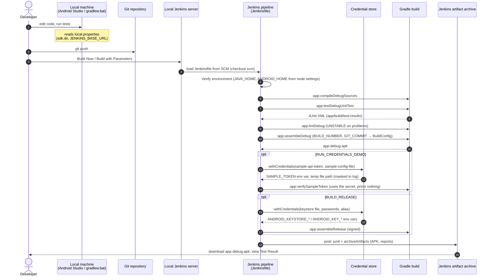

# 5. Pipeline walkthrough

## 5.1 End-to-end flow



**Where configuration comes from:**

- Local developer config is read **only** on the developer's machine (step 1, `local.properties`).
- Jenkins credentials are injected **only** inside the two `opt` blocks.
- Machine paths come from the Jenkins node's environment variables.

## 5.2 Stage by stage (root `Jenkinsfile`)

| Stage | Command | What you learn | Fails when |
|---|---|---|---|
| **Checkout** | `checkout scm` | Jenkins clones the repo/branch configured in the job (with the job's Git credential). `GIT_COMMIT` is set. | repo URL/credential wrong |
| **Verify environment** | `ci\windows\verify-env.bat` | Prints `JAVA_HOME`, `java -version`, `ANDROID_HOME`, installed platforms/build-tools. | no Java, no `ANDROID_HOME` |
| **Gradle wrapper** | `gradlew.bat --version` | The wrapper downloads the pinned Gradle 9.5.0, so the agent needs no Gradle install. | no internet / proxy |
| **Compile** | `:app:compileDebugSources` | A fast early failure for compile errors. | Kotlin/Java errors |
| **Unit tests** | `:app:testDebugUnitTest` | JVM tests, no emulator. XML goes to `app/build/test-results/testDebugUnitTest/`. | a failing test (build FAILED, report still published) |
| **Lint** | `:app:lintDebug` inside `catchError(… 'UNSTABLE')` | How to make a check non-fatal but visible (yellow build). | lint errors → UNSTABLE |
| **Build debug APK** | `:app:assembleDebug` | Produces `app-debug.apk`. `BUILD_NUMBER` becomes `versionCode` and `BuildConfig.CI_BUILD_NUMBER`. | packaging errors |
| **Credentials demo** *(param)* | `withCredentials` + `:app:verifySampleToken` | Secret text and secret file bindings; masking. | credential ID missing |
| **Release APK** *(param)* | `withCredentials` + `:app:assembleRelease` | Signing from Jenkins credentials only. | missing credentials / wrong password |
| **post → always** | `junit`, `archiveArtifacts` | Runs even if a stage failed, so test reports of a failing build are still visible. | never fails the build (`allowEmpty…`) |

`options`:

- `timeout(45 min)` kills stuck builds.
- `disableConcurrentBuilds()` prevents two builds from fighting over the same workspace and Gradle locks.
- `buildDiscarder` keeps disk use bounded (old APKs are deleted).

## 5.3 Why `--no-daemon --stacktrace --console=plain`

- `--no-daemon`: each CI build starts a fresh Gradle JVM and leaves nothing
  running. Jenkins builds aren't interactive, so the daemon's warm-up benefit is
  small, and stray daemons hold file locks in the workspace on Windows.
- `--stacktrace`: CI logs are all you have, so print the cause.
- `--console=plain`: no progress-bar escape codes in the Jenkins log.

## 5.4 Running the same steps locally (PowerShell)

The pipeline is just Gradle commands, so you can reproduce any stage locally:

```powershell
ci\windows\verify-env.bat
.\gradlew.bat --no-daemon --stacktrace :app:compileDebugSources
.\gradlew.bat --no-daemon --stacktrace :app:testDebugUnitTest
.\gradlew.bat --no-daemon --stacktrace :app:lintDebug
.\gradlew.bat --no-daemon --stacktrace :app:assembleDebug
```

A build that passes locally but fails on Jenkins almost always comes down to
an **environment difference**: JDK, SDK path/licenses, the service account's
permissions or proxy, or a file that exists only on your machine
(`local.properties`!). See [06-troubleshooting.md](06-troubleshooting.md).

## 5.5 Linux agent

`ci/linux/Jenkinsfile` has the same stages and IDs with `sh` steps and
`ci/linux/verify-env.sh`. Point the job's *Script Path* at it. `.gitattributes`
keeps `gradlew` and `*.sh` with LF line endings and `*.bat` with CRLF, so one
repository works on both kinds of agent.
